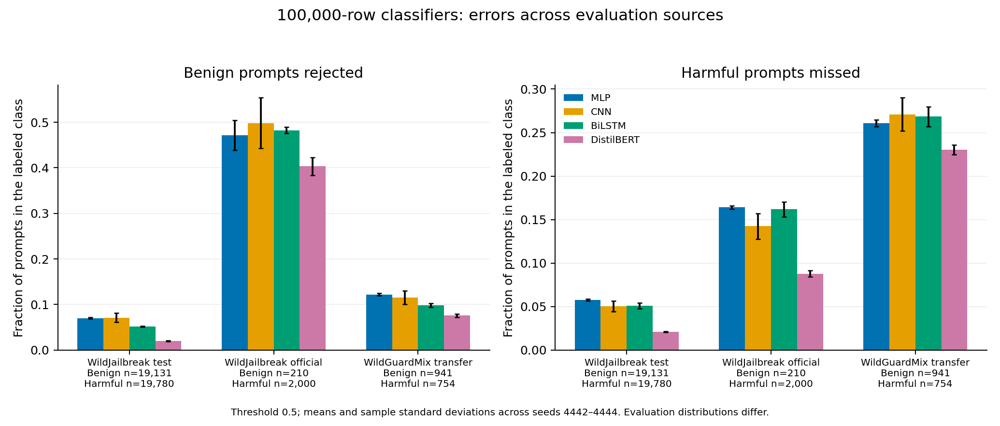

# LLM prompt detection

This project compares four models for detecting harmful prompts: a TF–IDF MLP, a sentence CNN, a BiLSTM, and DistilBERT. It includes data preparation, training, evaluation, and inference from the published checkpoints.

The reference experiments use 100,000 unique training prompts from [WildJailbreak](https://huggingface.co/datasets/allenai/wildjailbreak). The original three-epoch baseline and the longer runs across three seeds are complete. DistilBERT was fine-tuned across the full encoder and classification head.

[Models on Hugging Face](https://huggingface.co/DeeAxe/llm-prompt-detection) · [Baseline results](results/large/comparison.csv) · [Repeated-seed results](results/experiments/comparison.csv) · [Training configuration](configs/training_protocol.json)

## Three-epoch baseline

The shared test set contains 38,911 prompts. The official challenge provides a further 2,000 harmful and 210 benign prompts.

| Model | Test accuracy | Test F1 | Official harmful recall | Official benign acceptance |
| --- | ---: | ---: | ---: | ---: |
| TF–IDF MLP | 0.9353 | 0.9355 | 0.8000 | 0.5857 |
| CNN | 0.9258 | 0.9290 | 0.8585 | 0.4476 |
| BiLSTM | 0.9410 | 0.9423 | 0.8570 | 0.5571 |
| DistilBERT | 0.9789 | 0.9792 | 0.9055 | 0.6000 |


DistilBERT has the highest test F1, but rejects 40% of benign prompts in the official challenge. False positives remain a major issue. The baseline uses one training seed and mostly synthetic data. The repeated-seed results below extend its training budget. Training on larger pools is underway. Larger encoders and inference speed remain to be evaluated.

The labels describe prompt harmfulness. Evaluating prompt injection will require a separate experiment with application context.

## Repeated-seed results

All four architectures completed runs with seeds 4442, 4443, and 4444 on the same 100,000 training prompts. The epoch caps were ten for MLP/CNN/BiLSTM and five for DistilBERT, with validation-based early stopping after two epochs without improvement. Each run evaluates its best validation checkpoint at a fixed threshold of 0.5.

| Model | Baseline test F1 | Test F1, mean ± sample SD | Official benign acceptance, mean |
| --- | ---: | ---: | ---: |
| TF–IDF MLP | 0.9355 | 0.9377 ± 0.0007 | 0.5286 |
| CNN | 0.9290 | 0.9410 ± 0.0024 | 0.5016 |
| BiLSTM | 0.9423 | 0.9493 ± 0.0012 | 0.5175 |
| DistilBERT | 0.9792 | 0.9798 ± 0.0004 | 0.5968 |

DistilBERT remains the strongest on the shared test, with a small gain over its baseline. Its official benign acceptance is still about 60%, so false positives remain an important limitation.

[Full metrics](results/experiments/summary.json), [per-seed records](results/experiments/wildjailbreak-100k/), and [validation curves](results/experiments/validation_curves.csv) include the actual epochs, selected checkpoints, timings, and source hashes.

The MLP runner uses 256-row partial-fit batches; the earlier baseline used 1,000-row feature chunks with internal 256-row optimizer batches. The updated batching and seeded shuffle order are recorded through the training code revision.

## WildGuardMix transfer

The validation-selected 100,000-row models were evaluated on 1,695 filtered WildGuardMix test prompts. No WildGuardMix data was used for training or checkpoint selection. The threshold remained 0.5.

| Model | F1, mean ± sample SD | Harmful recall, mean | Benign acceptance, mean |
| --- | ---: | ---: | ---: |
| TF–IDF MLP | 0.7815 ± 0.0039 | 0.7392 | 0.8778 |
| CNN | 0.7783 ± 0.0125 | 0.7290 | 0.8845 |
| BiLSTM | 0.7890 ± 0.0094 | 0.7317 | 0.9015 |
| DistilBERT | 0.8257 ± 0.0014 | 0.7697 | 0.9242 |

These scores describe transfer to a different source and test distribution. [Transfer metrics](results/transfer/wildguardmix-transfer/summary.csv) include all three seeds and the source and checkpoint hashes.

## Error analysis

Saved predictions are compared by source, prompt family, length, and training seed. On WildGuardMix, 121 of the 754 prompts labeled harmful are missed by every architecture across all three seeds. DistilBERT's mean harmful miss rate is 23.03% there, compared with 2.10% on the shared WildJailbreak test.



[Slice metrics](results/error_analysis/wildjailbreak-100k/slices.csv) include class counts and seed variation. [Persistent error counts](results/error_analysis/wildjailbreak-100k/stable_errors.csv) separate errors shared by all three seeds from those that change across seeds. Length ranges are descriptive regex-token counts; DistilBERT uses WordPiece tokens. The evaluation sources have different distributions and label definitions.

```bash
python src/analyze_classifier_errors.py
python src/plot_classifier_errors.py
```

The analysis verifies prediction IDs, labels, and saved metrics before producing the tables. Prompt text and annotated review samples stay in ignored `traige/error_review/`. Re-running preserves those annotations when the selected samples match. Plotting uses Matplotlib; the figure provenance records the versions used.

## Training-size comparison

All sizes use the same held-out partitions, model settings, and three seeds. Vocabularies and TF–IDF statistics are fitted separately on each training pool. The 100,000-row runs are the completed reference. Epoch caps are fixed, so larger pools also allow more optimizer updates. The larger runs enable deterministic GPU operations; each condition records its runner revision.

The larger-pool runs are in progress. The table includes architectures with all three seeds complete.

| Training prompts | Model | Test F1, mean ± sample SD | Test MCC, mean |
| ---: | --- | ---: | ---: |
| 100,000 | TF–IDF MLP | 0.9377 ± 0.0007 | 0.8727 |
| 100,000 | CNN | 0.9410 ± 0.0024 | 0.8791 |
| 100,000 | BiLSTM | 0.9493 ± 0.0012 | 0.8969 |
| 100,000 | DistilBERT | 0.9798 ± 0.0004 | 0.9589 |
| 150,000 | TF–IDF MLP | 0.9408 ± 0.0004 | 0.8786 |
| 150,000 | CNN | 0.9452 ± 0.0033 | 0.8881 |
| 183,005 | TF–IDF MLP | 0.9427 ± 0.0006 | 0.8836 |
| 183,005 | CNN | 0.9499 ± 0.0004 | 0.8987 |

[Training-size metrics](results/experiments/scaling_comparison.csv) include per-condition means and standard deviations. Each run records its source, data hashes, actual epochs, and validation-selected checkpoint. The shared test was already used in the original baseline.

## Setup

Local training uses Python 3.10 and PyTorch 2.5.1. The Kaggle queues use Python 3.12 and PyTorch 2.10 in a pinned container. Each result records its actual environment. For a local installation:

```bash
python3.10 -m venv .venv
source .venv/bin/activate
pip install torch==2.5.1 --index-url https://download.pytorch.org/whl/cu121
pip install -r requirements-training.txt
```

For a CPU installation, use `https://download.pytorch.org/whl/cpu` as the PyTorch index URL. Model inference uses CPU by default; add `--device cuda` to use an NVIDIA GPU.

## Run inference

Load a model from the published Hugging Face repository:

```bash
python src/predict_large_models.py \
  --repo-id DeeAxe/llm-prompt-detection \
  --model distilbert \
  --text "Explain how rainbows form."
```

Choose `mlp`, `cnn`, `bilstm`, or `distilbert`. The helper downloads the selected checkpoint and preprocessing files, caches them, and runs inference locally. It returns the harmfulness probability, predicted label, and model revision as JSON. Label 0 is benign and label 1 is harmful; the decision threshold is 0.5.

Use `--revision COMMIT_SHA` to select a particular release, `--offline` to load an already cached release, or `--root /path/to/model-repository` to use a downloaded folder.

You can also call the helper from Python:

```python
from src.predict_large_models import PromptClassifier

classifier = PromptClassifier.from_hub(
    "DeeAxe/llm-prompt-detection", architecture="distilbert"
)
scores = classifier.probabilities([
    "Explain how rainbows form.",
    "Summarize this article.",
])
```

## Prepare the dataset

Accept the WildJailbreak access terms on Hugging Face and authenticate with `hf auth login`. Download the pinned source files, then prepare and audit the corpus:

```bash
hf download allenai/wildjailbreak train/train.tsv eval/eval.tsv README.md \
  --repo-type dataset --revision 5ddc12a7894f842b0619b8e1c7ee496b198af009 \
  --local-dir data/raw/large/wildjailbreak --cache-dir data/.hf-cache
python src/prepare_large_corpus.py
python src/audit_large_corpus.py
```

Preparation removes normalized duplicates and conflicting labels, keeps each original request with its adversarial variants, and selects 100,000 unique training prompts. Validation contains 39,502 prompts. Model responses are excluded from the inputs.

The audit checks exact prompt overlap across all partitions and underlying-request overlap across the main splits. The official evaluation omits the original request identifiers, so its overlap check is limited to exact text. Counts, source revisions, and file hashes are saved in [the data manifest](results/large/data_manifest.json).

The same ordering defines nested pools of 100,000, 150,000, and 183,005 unique training prompts. The larger pools contain the exact original 100,000-row prefix. Validation, test, and official evaluation files remain identical, with no measured prompt overlap between partitions and no underlying-request overlap in the grouped splits. [Frozen manifests and overlap checks](results/datasets/) record each condition. The original baseline and repeated-seed reference use the 100,000-row pool.

WildGuardMix provides a separate transfer evaluation. We use its prompt-harmfulness labels, discard missing labels, empty prompts, and conflicting duplicates, then remove prompts found in any WildJailbreak partition. Its official test retains **1,695 prompts: 754 harmful and 941 benign**. No WildGuardMix prompts are used to fit or select these classifiers. The [transfer configuration](configs/transfer_evaluation.json) fixes the checkpoints, seeds, and 0.5 threshold before evaluation.

The same filtering leaves **28,643 WildGuardMix training candidates** outside all WildJailbreak partitions and the WildGuardMix test. Combining these with the full WildJailbreak training pool would give **211,648 unique candidates**. This combined pool has not been trained on; the size comparison and transfer evaluation are separate experiments. Exact overlap can be measured, but the source does not provide the original requests needed to check semantic or request-level overlap. The [audit](results/datasets/wildguardmix-transfer/manifest.json) records the exclusions.

## Train the models

Run the MLP on CPU and the sequence models on GPU:

```bash
OPENBLAS_NUM_THREADS=1 OMP_NUM_THREADS=1 python src/train_large_mlp.py
python src/train_large_neural.py cnn --device cuda
python src/train_large_neural.py bilstm --device cuda
```

For full DistilBERT fine-tuning locally:

```bash
python src/download_encoder.py
python src/train_large_neural.py distilbert \
  --device cuda --batch-size 32 --epochs 3
```

Each run selects its checkpoint using validation F1. The input limit is 256 tokens; MLP, CNN, and BiLSTM use regex tokens, while DistilBERT uses WordPiece. Vocabulary and TF–IDF statistics are fitted on training data only. Checkpoints and predictions are saved under `artifacts/large/`, and aggregate metrics under `results/large/`.

The completed MLP run used local CPU, CNN and BiLSTM used an RTX 3060, and DistilBERT used one Kaggle T4. Model configurations and training budgets are recorded in [configs/training_protocol.json](configs/training_protocol.json).

### Train DistilBERT on Kaggle

The Kaggle package contains the prepared partitions, pretrained encoder, and training scripts. Authenticate the Kaggle CLI and replace `YOUR_USERNAME` with your account name:

```bash
uv tool install kaggle --python 3.11
python src/download_encoder.py
python src/package_kaggle.py --username YOUR_USERNAME
kaggle datasets create -p kaggle/input --keep-tabular
kaggle datasets status YOUR_USERNAME/wildjailbreak-100k-grouped
```

Once the dataset is ready, submit the training job:

```bash
kaggle kernels push -p kaggle/distilbert --accelerator NvidiaTeslaT4
kaggle kernels status YOUR_USERNAME/prompt-detection-distilbert-100k
python src/collect_kaggle_run.py \
  --kernel YOUR_USERNAME/prompt-detection-distilbert-100k --watch
```

The collector verifies the partition hashes and encoder fine-tuning checks before importing the checkpoint and results.

## Evaluate and compare

After all four runs are available locally:

```bash
python src/compare_large_results.py
python src/export_large_models.py
pip install matplotlib
python src/plot_large_results.py
python -m unittest discover -s tests -v
```

The comparison checks that all models used the same partitions and prediction identifiers. It produces a results table, CSV, and paired bootstrap intervals over test request groups. Per-model JSON files include validation history, classification and calibration metrics, data-type slices, parameter counts, timings, and file hashes.

## Extended experiments

The training runners select checkpoints by validation F1, use early stopping with patience two, and save optimizer, scheduler, random-number, and mixed-precision state. Seeds are 4442, 4443, and 4444. Epoch caps are ten for MLP/CNN/BiLSTM and five for DistilBERT.

Queue the three MLP runs on CPU followed by the three CNN runs on GPU:

```bash
python src/run_training_sweep.py
```

A single run can be started or resumed directly:

```bash
python src/train_experiment.py cnn --seed 4442 --device cuda
python src/train_experiment.py cnn --seed 4442 --device cuda --resume
```

Each condition, model, and seed has its own directory under `results/experiments/` and `artifacts/experiments/`. Prepared features can be reused across seeds. The recorded recovery checks compare interrupted and uninterrupted training in [results/protocol_verification/](results/protocol_verification/).

For Kaggle, export a committed source snapshot and package the training input:

```bash
python src/snapshot_training_source.py --output artifacts/training_source --copy-data
python src/package_training_kaggle.py --source-dir artifacts/training_source --username YOUR_USERNAME
kaggle datasets create -p kaggle/input/training_runners --keep-tabular
```

After the code dataset is ready, submit the two queues:

```bash
kaggle kernels push -p kaggle/distilbert_training --accelerator NvidiaTeslaT4
kaggle kernels push -p kaggle/bilstm_training --accelerator NvidiaTeslaT4
```

Independent seeds use separate GPUs. The second queue trains the three BiLSTM seeds and takes the remaining DistilBERT seed as a GPU becomes free. Both queues use the same source snapshot and prepared 100,000-row input.

Collect and validate the finished runs, then aggregate their metrics:

```bash
python src/collect_training_runs.py --source-dir artifacts/training_source --watch \
  --kernels YOUR_USERNAME/prompt-detection-distilbert-seeds \
            YOUR_USERNAME/prompt-detection-bilstm-distilbert-seeds
python src/aggregate_experiments.py
python src/summarize_training_results.py
```

The summary reports means and sample standard deviations across seeds, and identifies incomplete seed sets. Completed checkpoints and predictions remain outside GitHub.

## Repository layout

| Path | Contents |
| --- | --- |
| `src/` | Data preparation, training, evaluation, and inference scripts |
| `tests/` | Checks for data handling, metrics, and model behavior |
| `results/large/` | Current 100,000-row experiment and release records |
| `results/` | Earlier small-corpus results |
| `kaggle/distilbert/` | Kaggle training entry point |

Raw data, processed prompts, checkpoints, and prediction files stay in ignored local folders. Published checkpoints are hosted on Hugging Face.

The earlier DAN/JailbreakBench/Alpaca experiment remains available through `src/run_experiments.py` and [its result files](results/). It used 1,764 training prompts and a frozen DistilBERT encoder. Length differences and related templates made that corpus an easy classification problem, motivating the larger dataset.

## License

Project code is released under the [MIT license](LICENSE). Dataset and pretrained-model licenses are listed in their source documentation and the [model repository](https://huggingface.co/DeeAxe/llm-prompt-detection/blob/main/LICENSE.md).


For the larger training pools and transfer evaluation, download the pinned WildGuardMix files, materialize the audited datasets, and select a training condition:

```bash
hf download allenai/wildguardmix train/wildguard_train.parquet test/wildguard_test.parquet README.md \
  --repo-type dataset --revision d29c47f41c8b51348b5c8e8c81c039b3132b66d1 \
  --local-dir data/raw/large/wildguardmix
python src/prepare_dataset_conditions.py
python src/train_experiment.py mlp --protocol configs/dataset_scaling.json \
  --condition wildjailbreak-183005 --seed 4442 --device cpu
```

Use `wildjailbreak-150k` for the 150,000-row condition. Each pool fits its own vocabulary or TF–IDF statistics using only its training prompts. GPU training uses deterministic operations; [save/resume verification](results/protocol_verification/dataset_scaling_resume.json) checks all four architectures against uninterrupted runs. Original checkpoints and results are preserved.

Evaluate available validation-selected checkpoints on the frozen WildGuardMix transfer set:

```bash
python src/evaluate_transfer.py --device cuda
python src/summarize_training_results.py
```

The transfer evaluator skips training runs that have not finished and reuses verified evaluation records. Its metrics are in `results/transfer/wildguardmix-transfer/`; per-prompt predictions remain local. Training-size comparisons are written to `results/experiments/scaling_comparison.csv`.
