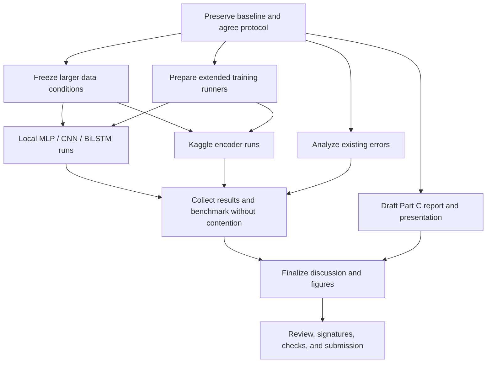

# Part C completion plan

The next stage extends the completed four-model comparison and prepares the final report, repository, and presentation. **Work marked “parallel” can proceed at the same time**, subject to the hardware limits below.

The saved submission schedule lists **31 October 2026, 11:59 PM** as the final deadline. With that deadline unchanged, prioritize the submission package and experiments that fit the remaining time. The stages below describe execution order rather than a new submission schedule.

## Already completed

- [x] Literature and dataset review.
- [x] WildJailbreak acquisition, cleaning, deduplication, and request-grouped splits.
- [x] Three-epoch MLP, CNN, BiLSTM, and full-encoder DistilBERT runs on 100,000 unique training prompts.
- [x] Shared test evaluation, official challenge results, length diagnostic, and request-group bootstrap intervals.
- [x] Checkpoint verification, Hugging Face publication, and repository-ID inference.
- [x] Part B report and task log; Part C report structure drafted with pending extension results.

The recorded experiment is in [results/large/](results/large/). Preserve these results when adding new runs.

## Work that can start together

| Track | Work | Resources | Dependencies |
| --- | --- | --- | --- |
| **A — Parallel: report** | Review the Part C draft and model methodology; fill pending results as experiments finish. | Writing and existing artifacts | Can start now |
| **B — Parallel: data** | Audit the larger WildJailbreak training subsets; assess access, prompt labels, and overlap for WildGuardMix. | Network, disk, and bounded CPU/RAM | Can start now; freeze each condition before training |
| **C — Parallel: training support** | Runner preparation is complete; use the verified runners for the longer and repeated experiments. | Code development and small checks | Completed and verified on Kaggle; ready for extended runs |
| **D — Parallel: analysis** | Review existing false positives and false negatives; prepare source/type breakdowns and the common-hardware benchmark procedure. | Existing predictions and CPU | Can start now; avoid contention during timed benchmarks |
| **E — Parallel: presentation** | baseline figures, contribution-page template, and submission checklist. | Writing and existing artifacts | Can start now; update figures after final analysis |

Keep edits to the single report source coordinated. Draft sections separately in notes and merge them into `report/report.tex` through one editor.

## Experiment sequence

### 1. Freeze the protocol and prepare the runners — completed

- [x] Record the baseline commit, source revisions, partition hashes, and model settings in `configs/part_c_protocol.json`.
- [x] Configure seeds `4442`, `4443`, and `4444` for repeated runs. Full repeated runs are scheduled in stage 2.
- [x] Keep validation-based checkpoint selection and the baseline decision threshold of 0.5.
- [x] Set epoch caps to ten for MLP/CNN/BiLSTM and five for pretrained encoders, with patience two and minimum improvement zero.
- [x] Save model, optimizer, scheduler, random-number, and mixed-precision state where applicable, with atomic checkpoints and mid-epoch resume.
- [x] Isolate every condition, architecture, and seed under the new experiment directories; retain the original baseline paths.
- [x] Add aggregation across conditions, seeds, and additional architectures, with smoke-test exclusion and configuration checks.

**Verification completed:** [Kaggle save/resume notebook](https://www.kaggle.com/code/deepamahuja/prompt-detection-protocol-resume-check). All four architectures completed uninterrupted and interrupted/resumed checks using 512 training prompts for two epochs. Final weights and predictions matched exactly. DistilBERT's encoder, optimizer, scheduler, RNG, and mixed-precision state checks passed. All 30 local baseline files in the frozen inventory remained unchanged.

Evidence: [Kaggle verification](results/protocol_verification/kaggle_resume_verification.json), [local verification](results/protocol_verification/local_resume_verification.json), and [runner instructions](EXPERIMENTS.md). These bounded smoke runs verify recovery behavior; the longer three-seed experiments below remain pending.

### 2. Longer runs and repeated seeds

- [ ] Train the four existing architectures on the same 100,000-row condition using the agreed longer budgets.
- [ ] Repeat the selected configurations across the three seeds.
- [ ] Record validation curves, actual epochs, selected checkpoints, training time, and test metrics.
- [ ] Report mean and standard deviation across seeds, alongside the original baseline.

**Parallel execution:** MLP can run on CPU while one CNN or BiLSTM job uses the local GPU, provided RAM is sufficient. DistilBERT can run on Kaggle at the same time. Report drafting, data audits, and analysis can continue alongside these runs.

**Done when:** all four architectures have comparable records for the selected condition and each scheduled seed. Validation determines configuration changes; final test scores are collected after selection. The existing test has already been used for the baseline, which should remain clear in the report.

### 3. Larger training sets and another data source

- [ ] Prepare nested WildJailbreak training subsets of 100,000, 150,000, and the full eligible 183,005 prompts. The existing 100,000-row subset should be included in the larger subsets.
- [ ] Retain the current validation/test assignments and rerun overlap checks for every condition.
- [ ] Fit vocabulary and TF–IDF statistics separately on each condition's training data.
- [ ] Compare the four architectures within each completed size condition. Prioritize the full-pool comparison if time permits only one additional size.
- [ ] Acquire and audit WildGuardMix using prompt-harmfulness labels. Count unique usable prompts after removing missing labels, duplicates, and cross-source overlaps.
- [ ] Define an additional-source training or transfer experiment before running it. Keep official evaluation data outside training and configuration selection.
- [ ] Consider a combined-source condition after the audit. Report its measured unique count; source totals may overlap.

**Parallel execution:** additional-source acquisition and audits can proceed while the existing models train. Training on a new condition starts after its manifest is frozen.

**Done when:** each reported condition has a manifest, label definition, overlap audit, and results for the models being compared. Additional data access or acquisition is still pending.

### 4. Larger model and capacity experiments

- [ ] Add support for DeBERTa-v3-base. The current encoder runner and gradient checks are specific to DistilBERT and need adaptation.
- [ ] Pin its source revision and run a memory/throughput pilot before choosing a training batch size.
- [ ] Fine-tune the larger encoder on a condition already used by the four baseline architectures.
- [ ] Compare classification quality, trainable/total parameters, memory, and inference latency.
- [ ] If resources remain, evaluate a separate 512-token condition and larger CNN/BiLSTM representations: 128-dimensional embeddings and doubled filter/hidden widths.

**Parallel execution:** a Kaggle encoder run can overlap local CNN/BiLSTM training. Schedule DistilBERT and DeBERTa jobs according to the available Kaggle GPU allocation and quota.

**Done when:** the larger model has a verified checkpoint and results under a documented shared condition. Introduce data size, context length, and capacity changes in separate comparisons so their effects can be assessed.

### 5. Error analysis and computational cost

- [ ] Review false positives and missed harmful prompts by data type and prompt length.
- [ ] Investigate the current 40% false-positive rate on official benign prompts and review a sample of natural benign requests.
- [ ] If adjusting the decision threshold, select it using validation data and report it alongside the fixed-0.5 result.
- [ ] Measure inference latency on the same hardware, with warm-up, fixed batches, and GPU synchronization where applicable. Include tokenization/preprocessing and report median and tail latency.
- [ ] Record memory use and separate checkpoint loading/download time from inference measurements.
- [ ] Report seed variation separately from request-group bootstrap uncertainty.

**Parallel execution:** error analysis can start from existing predictions and continue as new runs finish. Run timed benchmarks without competing training or other heavy jobs on the measured device.

**Done when:** the discussion explains performance differences, false positives, resource costs, and remaining limitations using recorded evidence.

## Hardware scheduling

| Resource | Schedule |
| --- | --- |
| Local CPU | MLP, preparation, and analysis. Check free RAM before combining heavy jobs; stagger feature preparation if memory becomes tight. |
| Local RTX 3060 | One training job at a time. Queue CNN/BiLSTM configurations and seeds. |
| Kaggle GPUs | Encoder training and larger-model pilots. Measure per-device memory use and available quota before scheduling overlapping jobs. |
| Writing and review | Continue during training; refresh tables and discussion as results become available. |

Different jobs can run on separate devices, but they should use separate output directories. Checkpoint frequently and keep the completed baseline available if access, memory, or quota limits interrupt an extension.

## Part C submission checklist

- [ ] Abstract, keywords, introduction, literature review, and objectives updated for the completed work.
- [ ] Methodology includes shared data preparation and a separate subsection for each model, written/reviewed by its assigned member.
- [ ] Experimental setup records hardware, dependencies, data versions, splits, seeds, training budgets, and selection rules.
- [ ] Results and discussion include common-metric comparisons, the length baseline, error slices, uncertainty, and computational cost.
- [ ] Conclusion summarizes supported findings; future work contains experiments still pending.
- [ ] Acknowledgement, assistance declarations, and at least 12 references checked.
- [ ] Current Part B risk/timeline text updated to reflect actual progress.
- [ ] Final contribution statement prepared on an extra page and signed by all three members.
- [ ] Repository instructions checked against the final code; selected checkpoints verified and published on Hugging Face.
- [ ] The single-file LaTeX report compiles and the PDF has been reviewed.
- [ ] A 10–12 minute presentation is rehearsed, with all members participating and prepared for Q&A.
- [ ] Required Turnitin and submission checks completed; PDF and repository link ready for submission.

**Submission priorities:** complete the report, discussion, reproducible baseline, contribution page, and presentation first. Add extended results as complete comparisons become available. Record unfinished experiments as future work.
